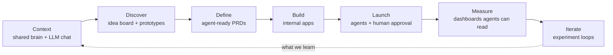
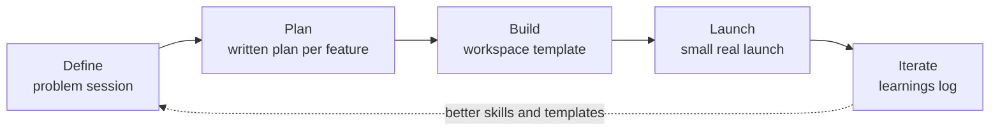

# Hi, I'm Marco

I build AI tools and agents, at work and at [OriginLabs](https://originlabs.pro), an AI product lab.

At OriginLabs, people who know a problem team up with AI-native builders, and we launch the product in weeks.

At work, I started the team's AI workspace: one shared brain with our company context, plus skills and tools anyone can use to ask data questions, pitch ideas, and build dashboards and MVPs.

Here I share templates, agent skills and examples you can clone and use in your own product and builder work. Lab products and experiments live in [OriginLabs](https://github.com/OriginLabs-pro).

### Lately, I've been working on

**In a product team: rebuilding the product development cycle with AI**

- **Context:** a shared brain for the team (company context, data definitions and a decision log) with an LLM chat that answers the team's questions from it
- **Discover:** a shared idea board where the team pitches and scores ideas with AI, and prototypes that let us test the best ones in hours
- **Define:** agent-ready PRDs, with the scope, context and acceptance criteria a coding agent needs to build the feature
- **Build:** internal apps the team uses every day, like one to write, preview and send customer messages safely
- **Launch:** agents that prepare customer campaigns, show a preview, send a test, and wait for a person to approve before anything goes out
- **Measure:** dashboards that also serve their numbers as JSON, so agents use the same official numbers as the team
- **Iterate:** experiment loops that close the cycle: agents read the results, propose the next test and set it up through MCP, and what we learn goes back into the shared brain

**At OriginLabs: finding a new product builder cycle**

Every product we launch is a test of the method.

- **Define:** a structured session that turns what a person knows about a problem into a product definition and landing-page copy to test
- **Plan:** a short written plan for every feature, so the agent gets a clear scope and we keep a record of what we built and why
- **Build:** a workspace template with the product's context and skills, so the coding agent knows the product from the first commit
- **Launch:** small launches with real users in weeks, each with a result agreed in advance that tells us whether to invest more
- **Iterate:** a learnings log we use to update our skills and templates after each product, so the next one is faster to build

I want AI to help people do better work, not to replace them.

### A bit about me

- **AI Product Manager at [Lendable](https://lendable.co.uk)**, leading product in Mexico
- **12+ years** building fintech and marketplace products from zero: Kontempo (founding PM, $30M seed), Centeo (acquired), Stori, Schibsted (8 markets)
- **Started as an engineer:** Android developer, then co-founder & CTO of ILLUTIO (UK, Ignite100)
- **Stack:** Python, TypeScript, Next.js, Claude Code, Anthropic API, MCP, n8n, SQL

[marco.center](https://marco.center) · [LinkedIn](https://linkedin.com/in/alvarezmarco)
